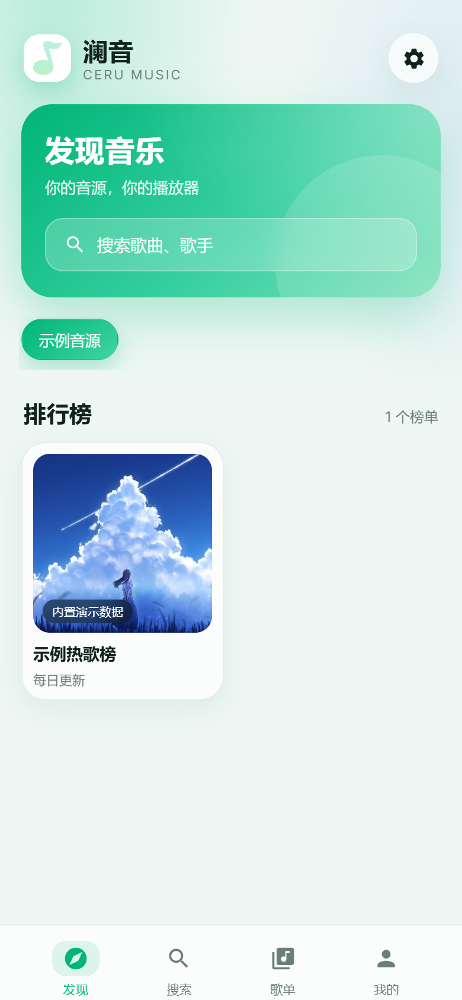
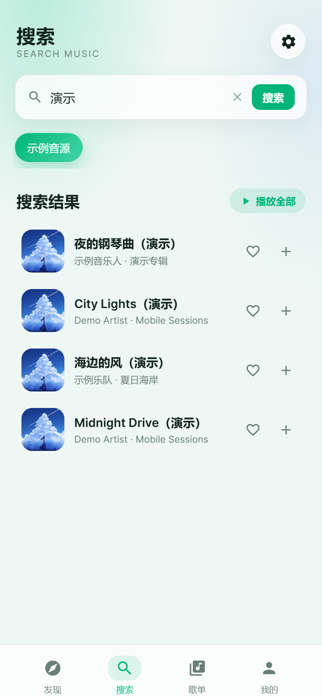
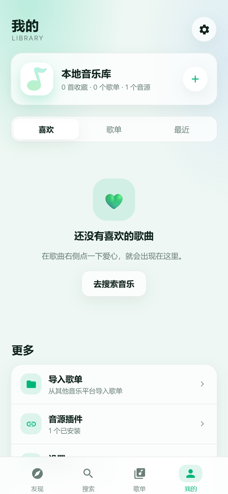
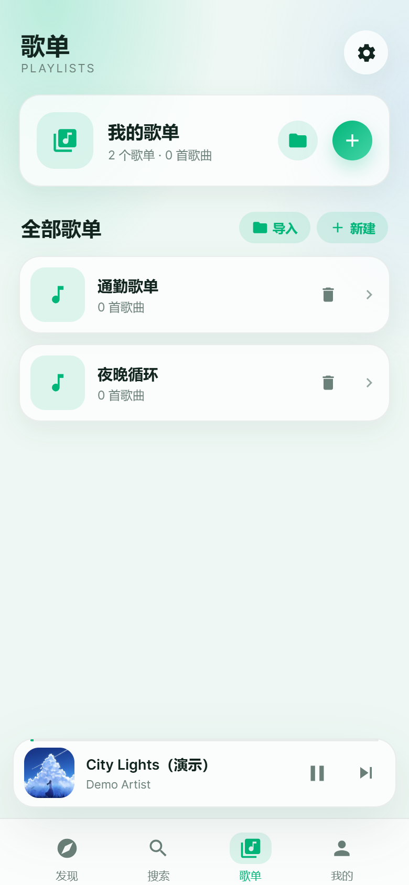
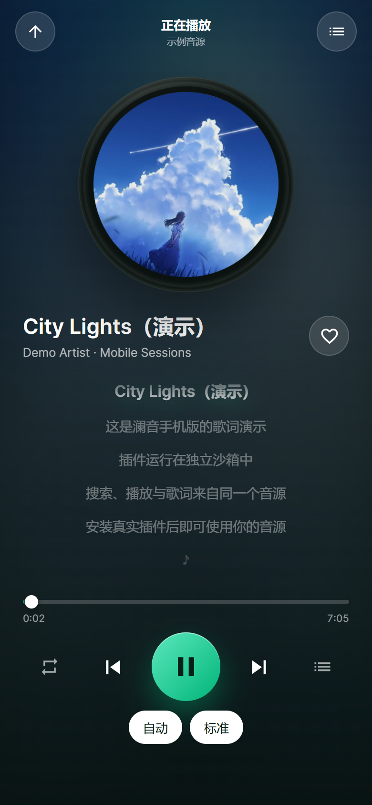
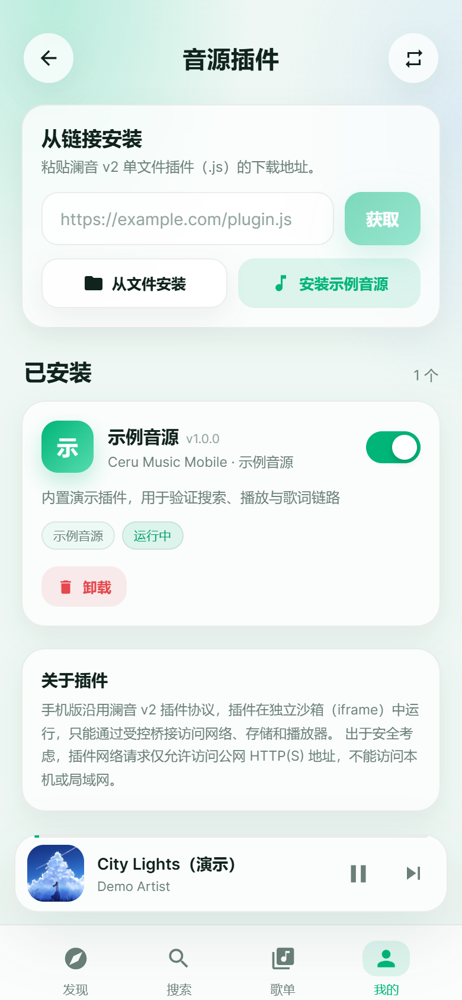

# 澜音 · CeruMusic 手机版

基于 [timeshiftsauce/CeruMusic](https://github.com/timeshiftsauce/CeruMusic) v2.3.1 移植的 Android 移动端。

- 仓库：https://github.com/baipiao5555/CeruMusic-Mobile
- 下载：https://github.com/baipiao5555/CeruMusic-Mobile/releases

澜音本身只提供插件运行框架和播放器，不存储、不提供任何音乐文件。歌曲搜索、歌词、播放地址都由你自行安装的合规 v2 插件提供。

## 截图

| 发现 | 搜索 | 我的 |
| --- | --- | --- |
|  |  |  |

| 歌单 | 播放页 | 插件管理 |
| --- | --- | --- |
|  |  |  |

## 功能

- 澜音 v2 单文件插件：从链接、本地文件安装，支持启用/停用、卸载、配置、签名校验
- 发现页：插件提供的榜单与推荐歌单
- 搜索：按插件音源搜索歌曲
- 歌单导入：通过插件提供的导入器，把 QQ音乐、网易云音乐、酷狗、酷我、咪咕等平台的歌单导入到本地
- 播放：队列、上一首/下一首、随机/单曲循环/列表循环、进度拖动
- 音质：自动选择当前歌曲可用的最高音质，也可手动选择标准、超高、无损、高清臻音、全景环绕、超清母带等插件支持的档位
- 歌词：逐行高亮，点击歌词跳转
- 收藏、本地歌单、播放历史
- 深色/浅色主题，跟随系统
- Android 前台媒体服务：后台播放、通知栏播放/暂停/上一首/下一首、锁屏媒体控制
- 数据全部保存在本机（IndexedDB / localStorage）

## 技术结构

```
src/
  core/plugin/      插件产物解析、iframe 沙箱、Host RPC、网络访问
  core/playback/    音频播放、队列、歌词、历史
  core/library.ts   收藏与本地歌单
  core/native/      Capacitor 原生桥接（后台媒体服务）
  views/            发现 / 搜索 / 我的 / 播放 / 设置 / 插件
android/            Capacitor Android 工程 + Java 前台媒体服务
public/plugin-runtime/  构建时从 @shiqianjiang/ceru-plugin-core 复制（不纳入版本库）
```

插件运行方式与桌面端一致：官方 `sandbox.js` 在 `sandbox="allow-scripts"` 的 iframe 中执行，通过 `postMessage` 与 Host 通信；Host 负责权限、HTTP、存储、播放器等受控能力。插件 JavaScript 不进入主界面上下文。

## 构建

要求：Node.js 22+、JDK 17、Android SDK 34、Gradle 8.8。

```bash
npm install
npm run build
npx cap sync android
cd android
gradlew.bat assembleRelease
```

插件运行时资源位于 npm 包内，`npm run dev` / `npm run build` 前会由 `prepare:plugin-runtime` 自动复制到 `public/plugin-runtime/`，不需要手动提交。

产物：`android/app/build/outputs/apk/release/app-release.apk`

开发调试：

```bash
npm run dev            # 浏览器端，默认 http://localhost:5180
npm run build:only     # 只构建 Web 资源
```

Android 签名配置在 `android/keystore.properties`（已加入 .gitignore）。首次构建前需要自行生成 keystore，或删除 `app/build.gradle` 中的 `signingConfig` 使用 debug 签名。

## 插件安全策略

- 仅接受澜音 v2 单文件产物（`exports.manifest` / `exports.activate`）
- 安装时静态读取清单，不执行插件代码
- 权限在安装确认页展示；插件首次使用未授权能力时会再次请求
- 插件网络请求仅允许 `http`/`https` 公网地址；明确拒绝 localhost、回环、私有与保留地址
- 响应体限制 16 MB，请求超时 60 秒，重定向最多 5 次
- 插件逻辑运行在独立 iframe 中，无法访问主界面 DOM 或本地数据

## 与桌面版的差异

手机版聚焦「音源插件 + 搜索 + 播放 + 歌词 + 本地收藏/歌单」。桌面版的以下功能暂未移植：

- 社区、AI、一起听、账号登录
- 本地音乐扫描与标签编辑、下载管理、DLNA
- 插件提供的 Web/Native Surface 页面（插件只作为音源使用）
- 部分插件服务接口（下载、房间、设备等）会返回「手机版暂不支持」

主界面、播放器和插件管理均已针对触屏与安全区适配。

## 许可与致谢

本项目是 CeruMusic 的衍生移植，遵循上游 **AGPL-3.0-only** 许可，见 `LICENSE`。

- 上游项目：https://github.com/timeshiftsauce/CeruMusic
- 插件运行时：`@shiqianjiang/ceru-plugin-core` / `ceru-plugin-sdk`
- 图标与品牌资源来自上游项目

本项目不分发任何音乐文件或第三方音源插件。请确保你安装和使用的插件符合当地法律法规。
