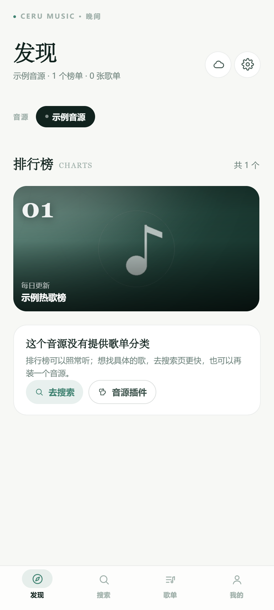
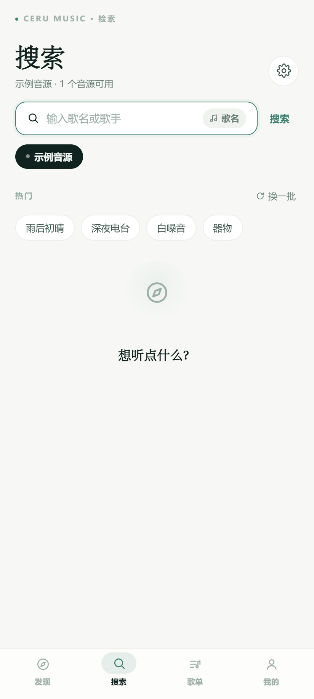
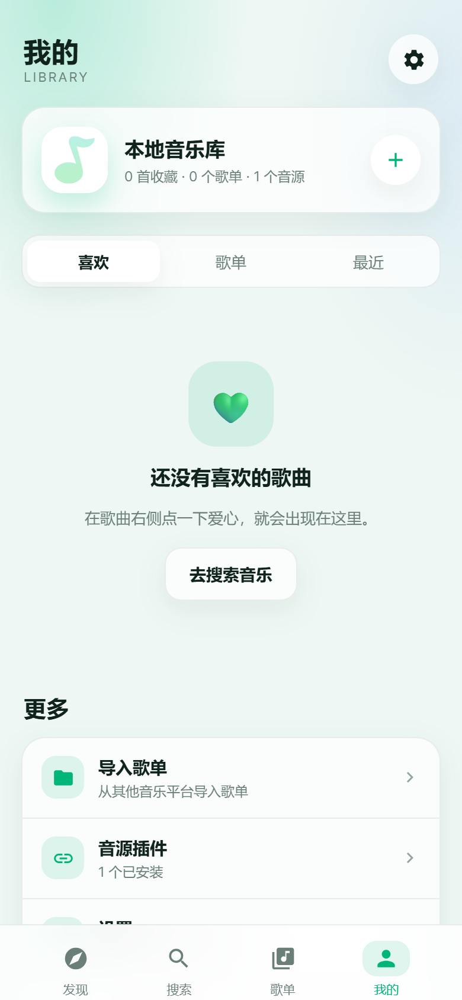
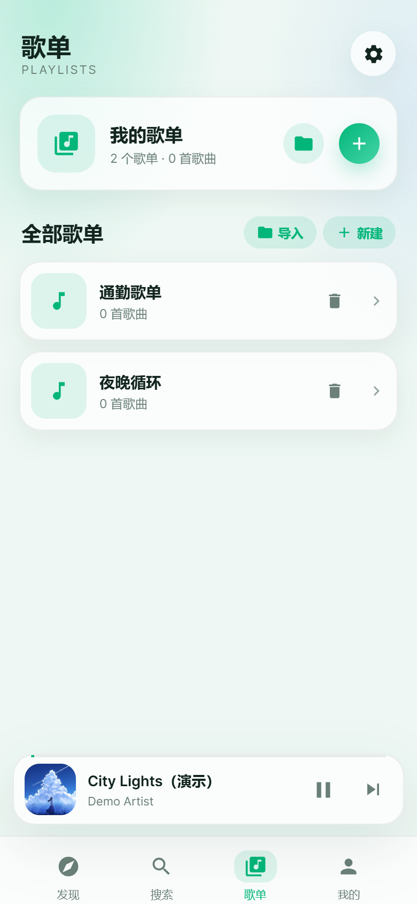
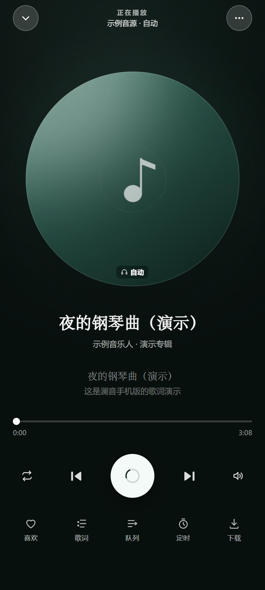
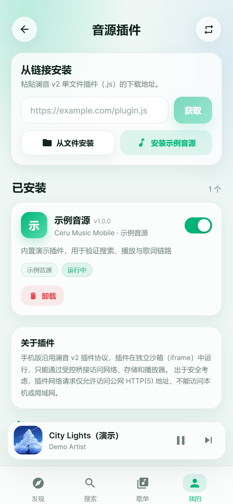

# 澜音 · CeruMusic 手机版

基于 [timeshiftsauce/CeruMusic](https://github.com/timeshiftsauce/CeruMusic) v2.3.1 移植的 Android 移动端。

- 仓库：https://github.com/baipiao5555/CeruMusic-Mobile
- 下载：https://github.com/baipiao5555/CeruMusic-Mobile/releases

澜音本身只提供插件运行框架和播放器，不存储、不提供任何音乐文件。支持自行安装澜音 v2 插件或洛雪 LX 音源；LX 模式由应用查询歌曲目录，播放地址由音源脚本解析。

## 截图

| 发现 | 搜索 | 我的 |
| --- | --- | --- |
|  |  |  |

| 歌单 | 播放页 | 插件管理 |
| --- | --- | --- |
|  |  |  |

## 功能

- 音源：从链接或本地文件安装澜音 v2 插件、洛雪 LX 脚本，支持启用/停用、卸载和链接更新；v2 插件继续支持配置与签名校验
- 洛雪兼容：按脚本实际声明提供酷我、酷狗、QQ、网易云、咪咕平台，保留歌曲 ID、音质哈希、歌词和封面信息；同平台可选择具体插件，已有歌曲仍优先使用原插件
- 发现页：插件提供的榜单与推荐歌单
- 搜索：输入时防抖联网联想包含关键词的歌名，去重后最多 10 条，并保留本地补充；回车/点搜索展示正式结果，支持排序、高亮、搜索历史、缩词重试与本地兜底
- 歌单导入：通过插件提供的导入器，把 QQ音乐、网易云音乐、酷狗、酷我、咪咕等平台的歌单导入到本地
- 播放：队列、上一首/下一首、随机/单曲循环/列表循环、进度拖动
- 播放封面：圆形封面随播放旋转，暂停与缓冲时停在当前角度；开启系统减少动态效果时不旋转
- 音质：自动选择当前歌曲可用的最高音质，也可手动选择标准、超高、无损、高清臻音、全景环绕、超清母带等插件支持的档位
- 歌词：逐行高亮，点击歌词跳转
- 云歌词：插件没有歌词时，自动从 LrcLib / QQ音乐 / 网易云 匹配同步歌词与翻译；播放页也可以手动触发匹配
- 收藏、本地歌单、播放历史
- 歌曲「更多」菜单：添加到歌单、新建歌单并添加、从当前歌单移除、下一首播放、加入播放队列、下载
- 歌单管理：新建、重命名、删除，支持下载全部
- 澜音账号登录：与电脑版共用同一个账号（Logto OAuth 2.0 + PKCE），登录页在系统浏览器打开，通过 `cerumusic://oauth/callback` 深链回到应用
- 云歌单同步：读取电脑版「上传到云端」的歌单，一键导入或更新到手机；导入时自动匹配本机已安装的音源插件
- 下载：原生流式下载到应用专属目录，实时进度、断点重下（重新下载）、取消、失败重试、下载管理页；下载完成后播放同一首歌会直接使用本地文件，可离线播放
- 应用内更新：启动时检查 GitHub Release（12 小时最多一次），发现新版本发系统通知；更新页展示更新说明，可直接下载 APK 并调起系统安装器覆盖安装
- 深色/浅色主题，跟随系统
- Android 前台媒体服务：后台播放、通知栏与锁屏显示歌曲封面、播放进度、播放/暂停/上一首/下一首、锁屏媒体控制
- Android 返回手势/返回键：优先关闭弹层，其次返回上一页，在底部主页面退出应用
- 左右滑动：播放页滑动切歌，主页面在发现 / 搜索 / 歌单 / 我的之间切换，可在设置中单独关闭
- 系统歌词共享：通过 Lyricon Provider 和 ColorOS 锁屏 `lyricInfo` 元数据，把当前歌词共享到状态栏、锁屏或车机；设置里可以开关和选择是否共享翻译
- 播放页设置面板：播放速度、歌词字号、歌词偏移（±0.5s）、显示翻译、定时停止（15/30/60 分钟或播完当前歌）、下载当前歌曲
- 设置项：主题与主题色、歌词字号、默认音质、播放模式、播放速度、显示歌词/翻译、云歌词来源、保持亮屏、耳机拔出暂停、歌词共享、下载音质、下载文件名格式、同时下载数量、手势开关、自动检查更新
- 悬浮胶囊底栏：底部导航改为悬浮样式，选中项带滑动指示器；页面切换与退出应用带淡出/缩放动画
- 数据全部保存在本机（IndexedDB / localStorage）；账号只保存 OAuth token，不保存密码

## 技术结构

```
src/
  core/plugin/      插件产物解析、iframe 沙箱、Host RPC、网络访问
  core/playback/    音频播放、队列、歌词、历史、插件音源解析
  core/lyrics/      云歌词匹配（LrcLib / QQ音乐 / 网易云）
  core/library.ts   收藏与本地歌单
  core/auth.ts      澜音账号登录（Logto OAuth PKCE + 深链回调）
  core/cloud.ts     云歌单读取与导入
  core/downloads.ts 下载队列、进度、离线文件
android/.../MediaPlaybackService.java  媒体服务、封面/进度、ColorOS 歌词与 Lyricon 发布
  core/updater.ts   应用内检查更新、下载与安装 APK
  core/native/      Capacitor 原生桥接（后台媒体服务、下载器、外部浏览器、安装器、通知）
  views/            发现 / 搜索 / 我的 / 播放 / 云端歌单 / 下载 / 更新 / 设置 / 插件
android/            Capacitor Android 工程 + 前台媒体服务 + 下载/安装/通知插件
public/plugin-runtime/  构建时从 @shiqianjiang/ceru-plugin-core 复制（不纳入版本库）
```

v2 插件继续使用官方 `sandbox.js` 与隔离 iframe。洛雪脚本在受限 Worker 中执行，不能访问主界面、修改宿主设置或直接发起网络请求；两者通过 `postMessage` 与 Host 通信，由 Host 检查权限和网络地址。

## 构建

要求：Node.js 22+、JDK 17、Android SDK 34、Gradle 8.8。

```bash
npm install
npm run build
npx cap sync android
cd android
gradlew.bat assembleRelease
```

插件运行时资源位于 npm 包内，`npm run dev` / `npm run build` 前会由 `prepare:plugin-runtime` 自动复制到 `public/plugin-runtime/`，不需要手动提交。

产物：`android/app/build/outputs/apk/release/app-release.apk`

Windows 下若 JDK 报 `Unable to establish loopback connection`，可在本次 PowerShell 会话中指定已存在的短临时目录，再重试 Gradle 构建：

```powershell
New-Item -ItemType Directory -Force 'D:/LX/.vite/jdk-tmp' | Out-Null
$env:JAVA_TOOL_OPTIONS = "$env:JAVA_TOOL_OPTIONS -Djdk.net.unixdomain.tmpdir=D:/LX/.vite/jdk-tmp -Djava.io.tmpdir=D:/LX/.vite/jdk-tmp".Trim()
```

## 发版与跟随上游

一条命令发版（递增版本号与 versionCode、构建、校验签名、生成 SHA-256、提交、打 tag、推送、创建 Release）：

```bash
npm run release
npm run release -- --dry-run          # 只打印步骤
npm run release -- --version 2.3.2-mobile.1
```

发版说明放在 `docs/release-v<版本>.md`，可用 `<!-- SHA256 -->` 和 `<!-- SIZE -->` 占位，脚本会回填。

检查桌面版是否有新版本、需要移植哪些文件：

```bash
npm run check:upstream
```

移植映射与清单见 [docs/upstream-sync.md](docs/upstream-sync.md)。`package.json` 的 `upstreamVersion` 记录当前移植到桌面版的哪个版本。

开发调试：

```bash
npm run dev            # 浏览器端，默认 http://localhost:5180
npm run build:only     # 只构建 Web 资源
```

Android 签名配置在 `android/keystore.properties`（已加入 .gitignore）。首次构建前需要自行生成 keystore，或删除 `app/build.gradle` 中的 `signingConfig` 使用 debug 签名。

### 回归检查

启动开发服务后，可在 PowerShell 中运行：

```powershell
$env:CERU_TEST_URL = 'http://127.0.0.1:5180'
node scripts/test-ui-races.mjs
node scripts/test-search-suggestions.mjs
node scripts/test-search-live.mjs
node scripts/test-player-artwork.mjs
node scripts/test-lx-catalog.mjs
node scripts/test-lx-quality.mjs
node scripts/test-lx-plugin.mjs
node scripts/test-network-policy.mjs
```

浏览器测试使用本机 Chrome，可用 `CHROME_PATH` 指定路径。洛雪回归使用受控测试脚本和拦截的网络响应，不下载或执行第三方音源。

## 插件安全策略

- 接受澜音 v2 单文件产物（`exports.manifest` / `exports.activate`）和带元信息的洛雪 LX 脚本
- 安装预览静态读取清单或脚本头，确认启用后才在隔离环境执行代码
- 权限在安装确认页展示；插件首次使用未授权能力时会再次请求
- 插件网络请求仅允许 `http`/`https` 公网地址；明确拒绝 localhost、回环、私有与保留地址
- 响应体限制 16 MB，请求超时 60 秒，重定向最多 5 次
- 插件逻辑与主界面隔离；洛雪 Worker 禁止直接联网，宿主桥接仅开放网络、权限查询和提示等必要接口
- 下载器对每一跳重定向都重新解析域名并做同样的公网校验，跨域重定向会丢弃 Authorization、Cookie 等敏感请求头
- 应用内更新只从本仓库 GitHub Release 的 HTTPS 地址下载 APK，同样经过下载器的逐跳校验；安装时通过 FileProvider 把文件交给系统安装器，不接受任意路径
- 账号 token 只保存在本机 localStorage，登录密码始终在系统浏览器中由认证服务处理，应用不会接触密码

## 与桌面版的差异

手机版聚焦「音源插件 + 搜索 + 播放 + 歌词 + 本地收藏/歌单 + 云歌单 + 下载」。桌面版的以下功能暂未移植：

- 社区、AI、一起听、播放设置云同步
- 本地音乐扫描与标签编辑、DLNA
- 插件提供的 Web/Native Surface 页面（插件只作为音源使用）
- 部分插件服务接口（房间、设备等）会返回「手机版暂不支持」

说明：

- 云歌单是**单向导入**：电脑版负责「上传到云端」，手机版负责读取并导入/更新到本地；手机端本地的改动不会回写云端。
- 下载保存到应用专属目录（`Android/data/com.ceru.music.mobile/files/Music`），卸载应用或清除数据会删除文件。
- 插件发起的下载（`services.downloads.*`）支持 list/create/pause/resume/cancel/retry，`reveal`（打开文件管理器）不支持。

主界面、播放器和插件管理均已针对触屏与安全区适配。

## 许可与致谢

本项目是 CeruMusic 的衍生移植，遵循上游 **AGPL-3.0-only** 许可，见 `LICENSE`。

- 上游项目：https://github.com/timeshiftsauce/CeruMusic
- 插件运行时：`@shiqianjiang/ceru-plugin-core` / `ceru-plugin-sdk`
- 云歌词匹配思路参考：[tomakino/LyricProvider](https://github.com/tomakino/LyricProvider)（Apache-2.0）；LyricProvider 是 LSPosed 模块，手机版没有直接复用它的代码，而是接入同类的公开歌词接口：LrcLib、QQ音乐、网易云
- 系统歌词共享：[Lyricon](https://github.com/proify/lyricon) Provider（Apache-2.0）；ColorOS 锁屏歌词参考 [ColorOS Live Lyrics Bridge](https://github.com/Andrea-lyz/ColorOS-Live-Lyrics-Bridge)
- 图标与品牌资源来自上游项目

本项目不分发任何音乐文件或第三方音源插件。请确保你安装和使用的插件符合当地法律法规。
